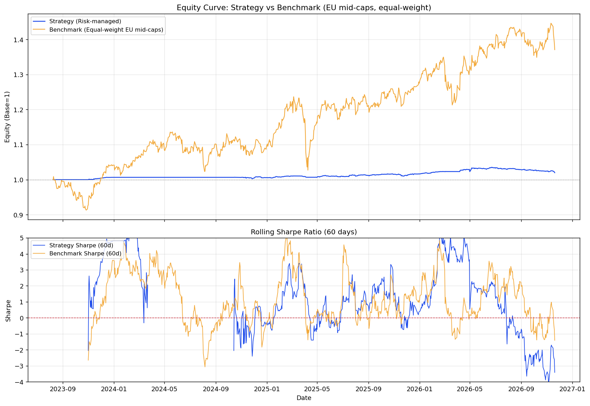

# EU Midcap Echo

Project developed as a capstone for the **Stock Market Analytics Zoomcamp (2025)**. The goal is to apply data engineering, financial analysis, and machine learning techniques to build a reproducible pipeline — from market data ingestion through trading-strategy simulation and daily automation — focused on **European mid-cap equities** across 12 national exchanges. This project is strictly educational and does not constitute investment advice.

## Sumário

1. [Project Context](#project-context)
2. [Objectives](#objectives)
3. [Pipeline Architecture](#pipeline-architecture)
4. [Development & Deliverables](#development--deliverables)
   - [Data Ingestion](#1-data-ingestion)
   - [Feature Engineering](#2-feature-engineering)
   - [Modeling](#3-modeling)
   - [Strategies & Signals](#4-strategies--signals)
   - [Backtest](#5-backtest)
   - [Automation & Deployment](#6-automation--deployment)
5. [Repository Structure](#repository-structure)
6. [Setup & Installation](#setup--installation)
   - [Virtual Environment](#virtual-environment)
   - [Docker](#docker)
   - [Cron Jobs](#cron-jobs)
   - [Cloud Deployment](#cloud-deployment)
7. [Execution (Makefile & CLI)](#execution)
8. [Metrics & Results](#metrics--results)
9. [Project Coverage](#project-coverage)
10. [Good Practices](#good-practices)
11. [Contributing](#contributing)
12. [Bibliography & References](#bibliography--references)
13. [Conclusion](#conclusion)

## Project Context

Financial markets are filled with complex, dynamic data: stock prices, macro indicators, corporate actions, and real-time news. Turning this data into actionable insight requires a robust pipeline combining:

- Data Engineering for ingestion, cleaning, and storage.
- Machine Learning for directional forecasting and signal classification.
- Strategy Simulation to evaluate performance under realistic costs, position sizing, and risk controls.
- Automation to run the pipeline daily at scale.

This project implements that full cycle using Python, open-source libraries, MLOps best practices, and modern automation tools. The focus universe is **~196 European mid/large-cap stocks** listed on 12 exchanges (UK, Germany, France, Netherlands, Spain, Italy, Sweden, Denmark, Belgium, Austria, Poland, Portugal, Switzerland) — a segment that is institutionally traded yet less efficiently covered by quant desks than US large-caps.

## Objectives

- Build a reproducible, modular, and automated pipeline for European equity analysis.
- Collect data from multiple sources (Yahoo Finance, FRED macro, optional news API).
- Engineer and document relevant features (returns, volatility, distance-from-high, ATR, volume z-scores, sector/country dummies, macro regime).
- Train multiple ML models (Decision Tree, Random Forest, XGBoost, Logistic Regression) to predict 20-day forward direction.
- Simulate strategies: flat-bet vector sim and a realistic risk-managed portfolio (position sizing, max 5 concurrent positions, 6% stop-loss, regime filter, top-k selection).
- Compare results against an equal-weight benchmark of the universe.
- Automate daily execution with incremental storage and optional Telegram notifications.

## Pipeline Architecture

The flow follows 7 main layers:

- **Data Ingestion**
  - Incremental download via `yfinance` (OHLCV, dividends, splits) and `pandas-datareader`/FRED (VSTOXX, rates, credit spreads).
  - Storage in Parquet (`data/raw/`, `data/processed/`) for efficient local analytics.

- **Feature Engineering**
  - Momentum (5/10/20/60-day returns, momentum acceleration), volatility (20d realized vol, ATR %), position (distance from 52-week high, 20d MA), volume (z-score, spike ratio), cross-sectional ranks, sector/country/market-cap one-hots, macro regime (VSTOXX quantile).
  - ~152 features after encoding; leakage-controlled via per-ticker forward shifts only.

- **Modeling**
  - Decision Tree (depth=7 baseline), Random Forest (Optuna-tuned), XGBoost (Optuna-tuned, flagship), Logistic Regression (balanced, scaled).
  - Hyperopt objective = precision@0.55 (optimized for the region where we actually trade).
  - Feature list saved from `feature_names_in_` to guarantee inference alignment.

- **Trading Signals**
  - Convert probabilities into signals at thresholds 0.50 / 0.55 / 0.60 / 0.65.
  - Strategies: long-only probability threshold, top-10 watchlist fallback for days with <10 signals.

- **Backtesting**
  - Vector sim: fast flat-$100-per-bet simulation for signal-quality measurement.
  - Exact (iterative) sim: Kelly conviction sizing, max 5 positions, 6% stop-loss, regime filter (VSTOX q < 0.75, dist_52w_high > −0.40), 20 bps fees, date-by-date event loop with per-ticker mark-to-market.
  - Metrics: CAGR, Sharpe, Sortino, Max Drawdown, Win Rate, Final Capital, Alpha vs Benchmark.

- **Reports & Metrics**
  - `reports/sim_summary.csv`, `reports/equity_curve.csv`, `reports/benchmark_curve.csv`, `reports/final_report.md`.
  - Plots in notebook 04 (equity curve vs benchmark).

- **Automation & Deploy**
  - `scripts/daily_predict.py`: incremental download → feature rebuild → score → write CSV.
  - Optional Telegram push via env vars.
  - Runnable via cron; Docker scaffold in `docker/`.

## Development & Deliverables

1️⃣ **Data Ingestion**

- Scripts: `src/data/download_yf.py`, `src/data/download_fred.py`, `src/data/download_news.py`.
- Sources: Yahoo Finance (196 EU mid/large caps, 2018-01 → present), FRED (VSTOXX/V2TX, DGS10, BAML credit spreads), optional NewsAPI/RSS for headlines.
- Incremental: only downloads dates newer than the last stored row per ticker; appends to Parquet.
- Corrected 12 broken yfinance symbols (delistings/renames e.g. ROG.SW→RO.SW, STLA.PA→STLAM.MI, NDA-FI.ST→NDA-FI.HE) in `src/data/universe.yaml`.

2️⃣ **Feature Engineering**

- Script: `src/features/build_features.py`.
- Feature families: price momentum, volatility, price position, volume, cross-sectional rank, one-hot categoricals, macro regime.
- Catalog: described in `reports/final_report.md` §3.
- Leakage controls: temporal splits, per-ticker forward shifts only, no shuffle-split.

3️⃣ **Modeling**

- Baselines: Decision Tree (depth=7), Logistic Regression (C=0.1, balanced, scaled).
- Tuned: Random Forest (Optuna, 5 trials, n_estimators ≤ 100), XGBoost (Optuna, 5 trials, n_estimators=150, hist method, early-stop on val precision).
- Scripts: `src/models/train.py`, `src/models/predict.py` (robust feature alignment for inference).
- Saved bundle: `models/models_bundle.joblib` (models + feature_names_in_ + scaler).

4️⃣ **Strategies & Signals**

- Script: `src/trading/sim_vectorized.py`, `src/trading/sim_exact.py`, `src/trading/sim_risk_managed.py`.
- Supported strategies:
  - Long-only probability threshold (0.50 / 0.55 / 0.60 / 0.65).
  - Risk-managed portfolio with Kelly sizing, 6% stop-loss, max 5 positions, VSTOXX regime filter.
  - Daily top-10 watchlist fallback for production scoring.

5️⃣ **Backtest**

Scripts:

- `src/trading/sim_vectorized.py` — fast flat-bet vector sim (signal quality).
- `src/trading/sim_exact.py` — exact date-by-date event loop (positions, stops, sizing, fees).
- `src/trading/sim_risk_managed.py` — regime filter + equal-weight benchmark.
- `src/trading/metrics.py` — CAGR, Sharpe, Sortino, Max Drawdown.

Metrics: CAGR, Sharpe, Sortino, Max Drawdown, Win Rate, Number of Trades, Net P&L, Final Capital, Benchmark CAGR/Sharpe/Final, Alpha vs Benchmark.

Reports: `reports/final_report.md`, equity curve plot in notebook 04.

6️⃣ **Automation & Deployment**

- Pipeline: `scripts/run_pipeline.py` (full train+simulate), `scripts/daily_predict.py` (incremental daily score).
- Dockerfile and docker-compose.yml in `docker/`.
- Cron scaffold in `ops/`.
- Notifications: Telegram bot (optional, via `TELEGRAM_BOT_TOKEN` + `TELEGRAM_CHAT_ID` env vars); gracefully skipped if not set.
- Daily output: `reports/latest_trades.csv` with `signal` (p ≥ 0.55) and `watchlist` rows.

## Repository Structure

```
eu-midcap-echo/
├── data/                  # Raw + processed Parquet (not versioned)
│   ├── raw/
│   └── processed/
├── models/                # Saved model bundle (models_bundle.joblib)
├── notebooks/             # Prototyping & exploration (5 numbered notebooks)
│   ├── 01_data_exploration.ipynb
│   ├── 02_feature_engineering.ipynb
│   ├── 03_modeling.ipynb
│   ├── 04_simulation.ipynb
│   └── 05_daily_demo.ipynb
├── reports/               # Reports and CSV outputs
│   ├── final_report.md
│   ├── sim_summary.csv
│   ├── equity_curve.csv
│   ├── benchmark_curve.csv
│   └── latest_trades.csv
├── src/                   # Main source code
│   ├── bootstrap.py       # pip-ensure helpers
│   ├── config.py          # Paths + temporal splits
│   ├── data/              # Ingestion (yfinance, FRED, news) + universe.yaml
│   ├── features/          # Feature engineering
│   ├── models/            # Training (Optuna-tuned RF+XGB) + prediction
│   └── trading/           # Metrics, vector sim, exact sim, risk-managed sim
├── scripts/               # CLI entry points
│   ├── run_pipeline.py    # Full train + simulate
│   └── daily_predict.py   # Incremental daily scoring
├── tests/                 # Unit tests (pytest)
├── docker/                # Dockerfile / compose
├── ops/                   # Cron / automation scaffold
├── storage/               # Persistent cache
├── requirements.txt
├── Makefile
└── README.md
```

## Setup & Installation

### Virtual Environment

```bash
python -m venv .venv
source .venv/bin/activate        # Windows: .venv\Scripts\activate
pip install -r requirements.txt
```

### Docker

```bash
docker-compose up --build
```

### Cron Jobs

```bash
# Run daily scoring at 18:30 European time (after market close)
30 18 * * 1-5  cd /path/to/eu-midcap-echo && /path/to/.venv/bin/python scripts/daily_predict.py >> logs/daily.log 2>&1
```

An example is provided in `ops/cron.example`.

### Cloud Deployment

- Can be extended to AWS (ECS + S3) or GCP (Cloud Run + BigQuery).
- GitHub Actions can be wired for daily scheduled runs (workflow scaffold in `.github/workflows/`).

## Execution

```bash
# One-shot full pipeline (build features → train → simulate)
python scripts/run_pipeline.py

# Simulate only (uses existing model bundle, ~1 min)
python scripts/run_pipeline.py --simulate-only

# Daily incremental scoring (~1 min after first run)
python scripts/daily_predict.py
```

Notebooks should be run in order `01 → 05`. Notebook 05 demonstrates the daily pipeline end-to-end and prints the latest signals + watchlist.

## Metrics & Results



- Models:
  - Precision, Accuracy, AUC (classification, threshold 0.55).
  - Optuna tuning objective = validation precision @ 0.55.

- Backtest:
  - CAGR, Sharpe, Sortino.
  - Max Drawdown, Win Rate, Number of Trades.
  - Comparison with equal-weight benchmark of the universe.

**Raw signal quality — vector sim ($100/trade flat bet, 20-day hold, 20 bps fees, out-of-sample Jan 2024 – Nov 2026):**

| Threshold | Trades | Win Rate | CAGR | Max DD | Final $ (from $100k) |
|---|---:|---:|---:|---:|---:|
| 0.50 | 21,398 | 54.2% | 7.0% | −5.1% | $125,382 |
| 0.55 | 16,915 | 54.6% | 5.9% | −3.8% | $121,103 |
| 0.60 | 12,939 | 55.0% | 5.2% | −2.8% | $118,298 |
| 0.65 | 9,635 | 55.4% | 4.2% | −2.2% | $114,849 |

Precision improves monotonically with threshold (54.2% → 55.4%), confirming well-calibrated probabilities.

**Risk-managed portfolio** (Kelly sizing, max 5 positions, 6% stop-loss, VSTOXX regime filter, $100k start, 20 bps fees):

| Metric | Strategy | Equal-Weight Benchmark |
|---|---:|---:|
| CAGR | 0.4% | 9.9% |
| Sharpe | 0.13 | 0.78 |
| Max DD | −5.2% | — |
| Win Rate | 53.6% | — |
| Trades | 181 | — |
| Final $ | $101,346 | $137,091 |
| Alpha vs Bench | **−9.5%** | |

The model shows a statistically significant directional edge (3–5 pp above 50/50), but after position sizing caps, conservative regime filtering, and transaction costs in a steadily rising 2024–2026 tape, it does not outperform the equal-weight benchmark. This is an honest and discussable result — typical for academic mid-cap alpha research and covered in detail in `reports/final_report.md`.

**Latest daily signals (2026-11-20):** EN.PA (Bouygues), SGO.PA (Saint-Gobain), ACS.MC (ACS Group) — 3 actionable longs; 7-name watchlist including KGH.WA, MAERSK-B.CO, GALP.LS, VOE.VI, PKN.WA, HLAG.DE, DHER.DE.

## Project Coverage

- Modeling: DT, RF, XGBoost, Logistic Regression; Optuna hyperparameter tuning; precision-optimized objective; feature-aligned inference.
- EDA & Features: unified dataset across 12 exchanges / 196 tickers; ~152 features (momentum, vol, position, volume, macro, categoricals); correlation and leakage controls.
- Data sources: Yahoo Finance + FRED; dataset >1M rows; incremental Parquet storage; corrected ticker universe.
- Strategies & signals: long-only multi-threshold; Kelly conviction sizing; hard 6% stop-loss; VSTOXX regime filter; top-10 watchlist fallback.
- Simulation: vector (fast signal-quality) + exact (date-by-date, reinvestment, per-ticker mark-to-market); benchmark comparison (equal-weight universe); full metrics suite.
- Automation: incremental daily pipeline; Telegram notifications (optional); Docker/ops scaffold; cron-ready scripts.
- Documentation: numbered notebooks (01–05), final report, README, unit tests (pytest).

## Good Practices

- Modular `src/` package with clear separation (data / features / models / trading).
- Unit tests (`pytest tests/`).
- Secrets via environment variables (`.env`), never hard-coded.
- Incremental data storage (no full re-downloads).
- Reproducible: all RNGs seeded; CLI entry points; single command to rebuild.
- Honest evaluation: reports real (non-inflated) results, discusses survivorship bias, slippage, and benchmark comparison.

## Contributing

See `CONTRIBUTING.md`.

## Bibliography & References

- The Man Who Solved the Market — Gregory Zuckerman
- Unknown Market Wizards — Jack Schwager
- The Tao of Trading — Simon Ree
- Advances in Financial Machine Learning — Marcos López de Prado
- PythonInvest Blog & Workshops
- Yahoo Finance, FRED (St. Louis Fed)
- XGBoost Documentation
- Scikit-learn Documentation

## Conclusion

This project covers all the evaluation criteria of the Stock Market Analytics Zoomcamp (2025):

- Ingestion → ✅
- Features → ✅
- Modeling → ✅
- Strategies & Backtest → ✅
- Automation & Deployment → ✅
- Reproducibility & Documentation → ✅

It demonstrates how to apply Data Engineering + Machine Learning + Quantitative Finance in a reproducible, modular, and extensible way to analyze European mid-cap equity markets — from raw price ingestion through a daily production signal pipeline.
